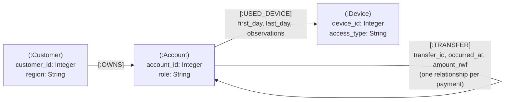

# Neo4j graph schema (Section 3.1)

Render at https://mermaid.live and export PNG for the report.

## Source field → graph mapping

| Source stream.field | Graph element | Neo4j import header |
|---|---|---|
| customers.customer_id | `:Customer.customer_id` (unique) | `customer_id:ID(Customer)` |
| customers.region | `:Customer.region` | `region:string` |
| accounts.account_id | `:Account.account_id` (unique) | `account_id:ID(Account)` |
| accounts.customer_id | `(:Customer)-[:OWNS]->(:Account)` start node; ignored on the node | `:IGNORE` in accounts.csv; `:START_ID(Customer)` in owns.csv |
| accounts.role | `:Account.role` | `role:string` |
| devices.device_id | `:Device.device_id` (unique) | `device_id:ID(Device)` |
| devices.access_type | `:Device.access_type` | `access_type:string` |
| account_devices.account_id | `[:USED_DEVICE]` start node | `:START_ID(Account)` |
| account_devices.device_id | `[:USED_DEVICE]` end node | `:END_ID(Device)` |
| account_devices.first_day / last_day / observations | `[:USED_DEVICE]` properties | `first_day:int, last_day:int, observations:int` |
| transfers.transfer_id | `[:TRANSFER].transfer_id` | `transfer_id:long` |
| transfers.sender_id | `[:TRANSFER]` start node | `:START_ID(Account)` |
| transfers.receiver_id | `[:TRANSFER]` end node | `:END_ID(Account)` |
| transfers.occurred_at | `[:TRANSFER].occurred_at` (range index) | `occurred_at:long` |
| transfers.amount_rwf | `[:TRANSFER].amount_rwf` | `amount_rwf:int` |

ID groups `Customer`, `Account` and `Device` keep the integer ID spaces separate, so Customer 7, Account 7 and Device 7 are different nodes.
Each transfer row becomes its own `TRANSFER` relationship, so repeated payments between the same two accounts stay separate events with their own time and amount.

Expected totals: 704,600 nodes (228,000 + 248,000 + 228,600) and 20,536,900 relationships (248,000 + 285,600 + 20,003,300).
