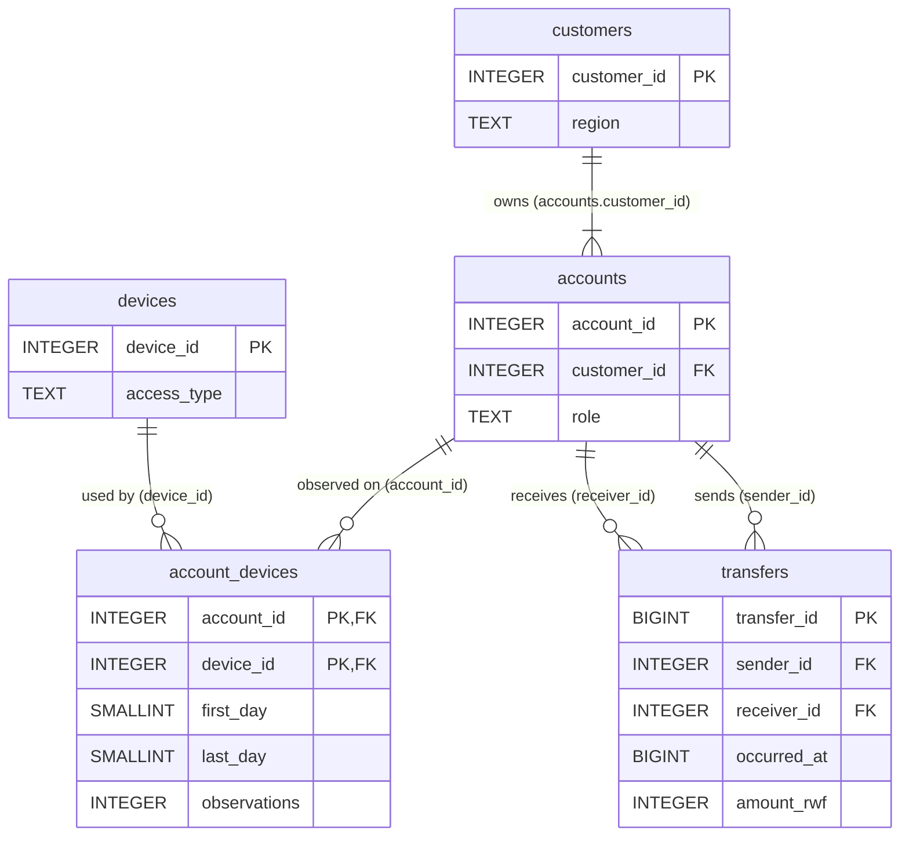

# PostgreSQL schema (Section 2.1)

Render the diagram at https://mermaid.live (paste the block) and export PNG for the report.

## Field meanings and units

| Table | Field | Type | Meaning / unit |
|---|---|---|---|
| customers | customer_id | INTEGER, PK | Customer identifier (1–228,000) |
| customers | region | TEXT | Home region: Kigali, Northern, Southern, Eastern, Western |
| accounts | account_id | INTEGER, PK | Wallet identifier (1–248,000) |
| accounts | customer_id | INTEGER, FK → customers | Owner of the wallet; a customer may hold several wallets |
| accounts | role | TEXT | `person` (1–240,000), `merchant` (240,001–246,000), `agent` (246,001–248,000) |
| devices | device_id | INTEGER, PK | Device identifier (1–228,600) |
| devices | access_type | TEXT | `handset` or `public_terminal` |
| account_devices | account_id, device_id | INTEGER, composite PK, FKs | One observed account–device association |
| account_devices | first_day, last_day | SMALLINT, CHECK 0 ≤ first ≤ last ≤ 29 | Inclusive observation interval; day 0 = 1 Sep 2026 CAT, day 29 = 30 Sep |
| account_devices | observations | INTEGER, CHECK > 0 | Number of times the account was seen on the device within the interval (a count, not a duration) |
| transfers | transfer_id | BIGINT, PK | Event identifier, unique per payment |
| transfers | sender_id, receiver_id | INTEGER, FKs → accounts | Paying and receiving wallets |
| transfers | occurred_at | BIGINT | Event time in Unix seconds (UTC epoch); shown in CAT = UTC+02:00 |
| transfers | amount_rwf | INTEGER, CHECK > 0 | Amount in whole Rwandan francs |

Notes: device observations do not identify which device initiated a payment. Transfers are wallet-to-wallet movements, not a ledger of balances, fees or reversals.
